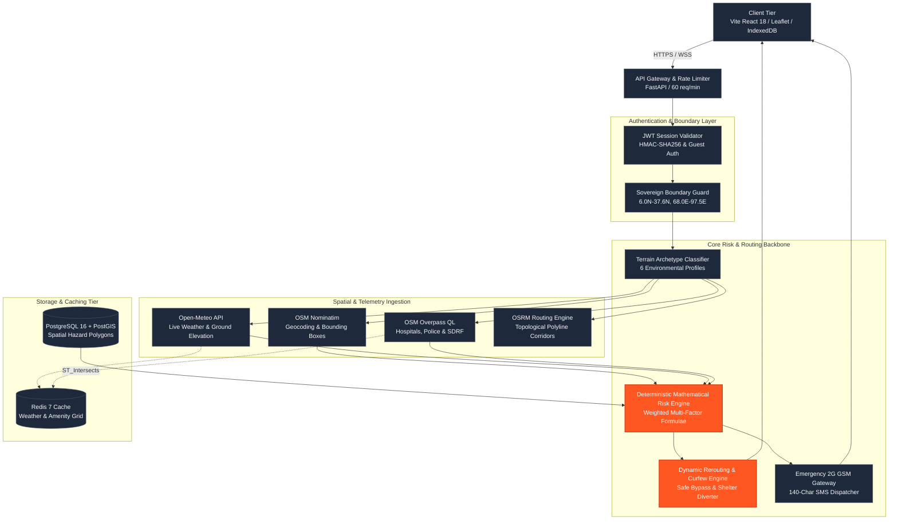
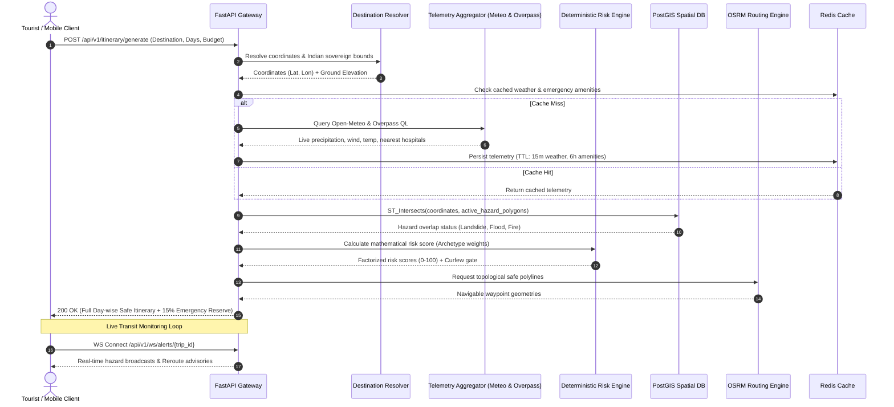
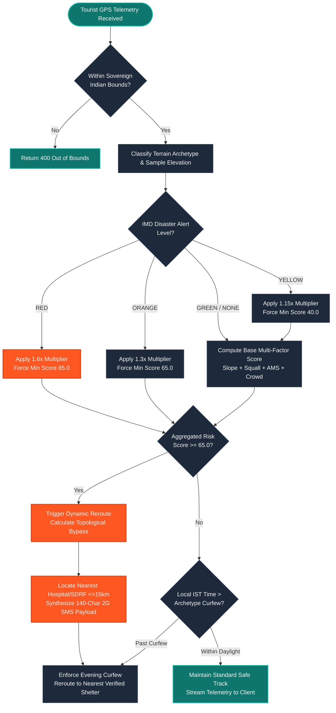
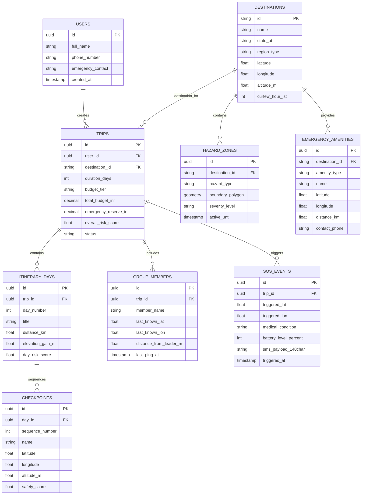
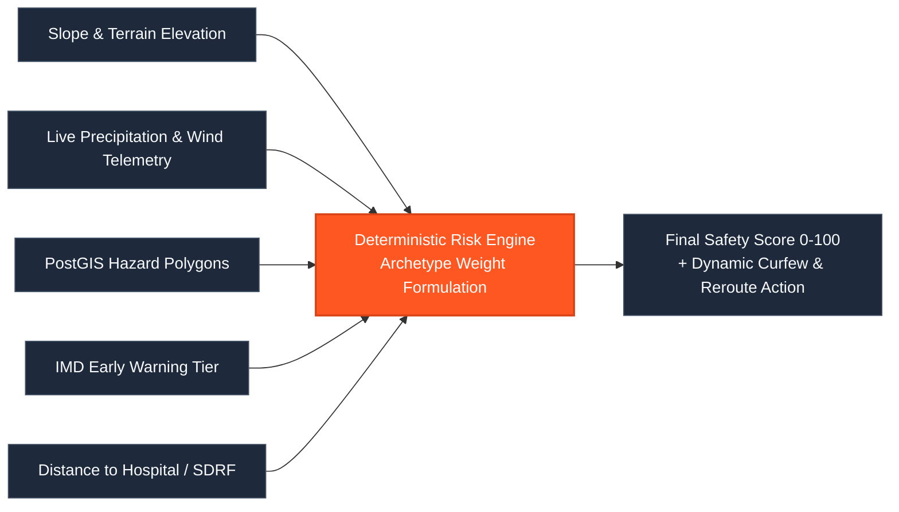

# IGNITE: Sovereign-Scale Pan-India Tourist Safety & Smart Route Engine
> **Deterministic, mathematically explainable risk intelligence, spatial geofencing, and dynamic topological re-routing across all 28 States and 8 Union Territories of India.**

[](https://opensource.org/licenses/MIT)
[](https://github.com/arnnnnaaavvvvv/IGNITE)
[](https://github.com/arnnnnaaavvvvv/IGNITE)
[](https://ignite-lemon-nu.vercel.app)
[](https://fastapi.tiangolo.com)
[](https://reactjs.org)
[](https://postgis.net)
[](https://github.com/arnnnnaaavvvvv/IGNITE)

🌐 **Live Production Application**: [https://ignite-lemon-nu.vercel.app](https://ignite-lemon-nu.vercel.app)

---

## Overview

**IGNITE** is a destination-agnostic tourist safety and dynamic itinerary engine engineered for the Indian subcontinent. Traditional travel platforms operate as static catalog directories or black-box recommendation models that remain oblivious to active cloudbursts, high-altitude acute mountain sickness (AMS), flash floods, and crowd stampede dynamics. IGNITE replaces opaque machine learning heuristics with **deterministic, multi-factor mathematical risk engines** paired with live geospatial telemetry (India Meteorological Department alerts, Open-Meteo atmospheric forecasts, real ground elevation sampling, PostGIS hazard polygon intersections, and Overpass QL emergency services). Whether a traveler inputs a high-altitude Himalayan trek, a coastal Bay of Bengal beach, a dense national park, a Thar desert dune, an urban heritage circuit, or a riverine pilgrimage corridor, IGNITE automatically classifies the environmental terrain archetype (`HILL_MOUNTAIN`, `COASTAL_MARINE`, `FOREST_WILDLIFE`, `DESERT_ARID`, `URBAN_HERITAGE`, `PLAINS_RIVERINE`), calculates an explainable safety score ($0.0 - 100.0$), enforces dynamic sunset curfews, and reroutes itineraries around active danger corridors with an enforced **15% emergency liquidity reserve**.

---

## Feature Table

| Feature | Description |
| :--- | :--- |
| **Destination-Agnostic Geocoding** | Resolves arbitrary Indian landmarks and tourist waypoints into latitude, longitude, and elevation profiles via OSM Nominatim and Open-Meteo, bounded strictly to sovereign Indian territory (`6.0°N–37.6°N`, `68.0°E–97.5°E`). |
| **6-Profile Environmental Risk Engine** | Dynamically swaps weight matrices across six archetypes (`HILL_MOUNTAIN`, `COASTAL_MARINE`, `FOREST_WILDLIFE`, `DESERT_ARID`, `URBAN_HERITAGE`, `PLAINS_RIVERINE`) to calculate deterministic $0 - 100$ risk indices without black-box hallucinations. |
| **Dynamic Topological Re-Routing** | Continuously evaluates live traveler GPS coordinates against active danger polygons and IMD weather warnings; recalculates safe bypass paths via OSRM when sector risk surpasses $65.0$. |
| **Curated National Pilgrimage Circuits** | Pre-seeded with 21 high-traffic sacred sites across 4 national circuits (Char Dham, Chota Char Dham, 12 Jyotirlingas, Prominent Shrines) with dynamic crowd density and staircase exertion tiers. |
| **PostGIS Spatial Geofencing** | Executes hardware-accelerated spatial polygon intersections (`ST_Intersects`) between planned routes and geological debris slides, floodplains, and high-tide buffer zones. |
| **Emergency SOS & 2G GSM Dispatch** | Discovers nearest verified hospitals, police stations, and SDRF bases within a 15km radius via Overpass QL and synthesizes a compact 140-character SMS payload for zero-internet 2G cellular dead zones. |
| **IndexedDB Offline Persistence** | Caches full itinerary polylines, hazard boundaries, and emergency node coordinates into client browser IndexedDB (`IgniteOfflineDB`) for uninterrupted operation during mountain network dropouts. |
| **Group Mesh Radar & Dispersion Alert** | Monitors peer-to-peer distances between tour group members using Haversine formulas, sounding instant audible alarms if any member strays past $150\text{m}$. |
| **Multilingual Voice Briefings** | Converts mathematical risk factor telemetry into natural-language safety briefings via the Web Speech API with English and Hindi synthesis. |
| **Regulated Budget Allocation** | Dynamically distributes user travel funds across transport, lodging, meals, and permits while strictly locking a non-negotiable **15% emergency medical reserve**. |

---

## What It Can Do Now

- **Resolve Any Indian Destination**: Geocodes any freeform Indian query (e.g., *"Munnar Top Station"*, *"Kedarnath Temple"*, *"Puri Blue Flag Beach"*) and samples true ground elevation in meters without hardcoded place tables.
- **Enforce Dynamic Environmental Curfews**: Automatically clamps evening transit hours based on ecosystem classification (e.g., 17:00 IST for wildlife zones, 17:30 IST for alpine snow trails, 19:00 IST for coastal beaches, 21:30 IST for plains pilgrimages, 22:00 IST for urban centers).
- **Compute Road & Trail Polylines**: Streams verified walking paths and motorable routes with distance and elevation gain metrics using OSRM.
- **Simulate Catastrophic Weather Injections**: Validates system resilience against simulated Himalayan cloudbursts, Bay of Bengal cyclones, Brahmaputra floods, and Thar heatwaves via an interactive testing workbench.
- **Broadcast Real-Time WebSocket Alerts**: Pushes telemetry updates, weather transitions, and boundary breaches directly to connected clients over `/api/v1/ws/alerts/{trip_id}`.
- **Enforce Sovereign Geographic Boundaries**: Instantly rejects coordinates outside Indian jurisdiction, preventing spoofing and telemetry corruption.
- **Provide 100% Deterministic Risk Breakdown**: Generates an explainability matrix breaking down exact percentage weights for landslide slope, squall intensity, hypoxia, isolation, and crowd surge.

---

## The Problem

| Dimension | Generic Travel Apps (Google Maps, MakeMyTrip) | Static Government Advisories (State SDMA / IMD PDFs) | Manual Trip Planning | IGNITE (This Engine) |
| :--- | :--- | :--- | :--- | :--- |
| **Risk Data Inputs** | Traffic congestion and distance only; blind to landslides, flash floods, and AMS. | Static district-level text bulletins without waypoint GPS coordinates. | Anecdotal travel blogs and outdated forums. | **Live multi-source telemetry (IMD alerts, real elevation, Overpass emergency grid, PostGIS hazard polygons).** |
| **Real-Time Adaptation** | Re-routes exclusively for road traffic delays; ignores weather and disaster vectors. | None; updated manually every 12 to 24 hours. | No automated capabilities during live transit crises. | **Sub-second dynamic rerouting to safe topological bypass corridors and verified shelters over WebSockets.** |
| **Explainability** | Opaque travel time estimates with no underlying safety breakdown. | Broad narrative alerts without mathematical scoring. | Subjective intuition and guesswork. | **Deterministic, weighted 4–5 factor scoring ($0 - 100$) with English and Hindi voice explanations.** |
| **Geographic Coverage** | Global street networks, lacking specialized environmental disaster models. | Fragmented across disconnected state portals; limited to selected pilgrim tracks. | Constrained by traveler's prior personal knowledge. | **100% Pan-India coverage (All 28 States & 8 Union Territories) across 6 canonical environmental profiles.** |
| **Offline Resilience** | Limited offline map caching; fails when cellular data drops completely. | Static PDFs require active web browser sessions. | Physical paper notes or memory. | **IndexedDB client-side database + 140-character 2G GSM SMS payload for connectivity dead zones.** |
| **Operational Overhead** | Expensive proprietary routing APIs with closed data silos. | Manually parsed by emergency coordinators during incidents. | High cognitive burden on traveler. | **Zero black-box ML overhead; open-source stack (FastAPI, PostGIS, Nominatim, Overpass QL, OSRM).** |

---

## Get Started

### Prerequisites
- **Python**: 3.11+
- **Node.js**: 18.x or 20.x LTS
- **PostgreSQL**: 15+ with PostGIS extension (or SQLite fallback for local development)
- **Redis**: 7+ (optional; in-memory fallback enabled by default)

### 1. Clone Repository & Setup Backend
```bash
git clone https://github.com/arnnnnaaavvvvv/IGNITE.git
cd IGNITE/apps/api

# Create and activate virtual environment
python -m venv venv
# On Windows:
.\venv\Scripts\activate
# On Linux/macOS:
source venv/bin/activate

# Install dependencies
pip install -r requirements.txt

# Start FastAPI server (Port 8000)
python -m uvicorn app.main:app --port 8000 --host 127.0.0.1 --reload
```

### 2. Setup Frontend Web Application
```bash
# In a separate terminal
cd ../../apps/web

# Install dependencies
npm install

# Start Vite React development server (Port 5173)
npm run dev
```

Access the frontend application at `http://localhost:5173`. Interactive Swagger API documentation is available at `http://localhost:8000/api/v1/docs`.

---

## Docker Quick Start

Deploy the entire production stack (FastAPI Backend, Vite React Client, Redis Cache) with Docker Compose:

```bash
# Start all containers in detached mode
docker compose up --build -d

# Verify system health
curl -s http://localhost:8000/health | jq .
```

### Example Health Check Response
```json
{
  "status": "healthy",
  "service": "IGNITE — Pan-India Tourist Safety Engine",
  "version": "2.1.0",
  "supported_region_types": [
    "HILL_MOUNTAIN",
    "COASTAL_MARINE",
    "FOREST_WILDLIFE",
    "DESERT_ARID",
    "URBAN_HERITAGE",
    "PLAINS_RIVERINE"
  ],
  "redis_caching": "ACTIVE (Async Redis / Fast InMemory Fallback)",
  "spatial_engine": "PostGIS / Shapely Polygon Intersection",
  "coverage": "All 28 States & 8 Union Territories of India"
}
```

---

## Example input → output

### Example Input Request
A traveler requesting a 2-day itinerary for Munnar Top Station with a Moderate fitness profile and an allocated budget:

```json
{
  "destination": "Munnar Top Station",
  "duration_days": 2,
  "budget_tier": "STANDARD",
  "total_budget_inr": 12000.0,
  "fitness_level": "MODERATE",
  "language": "en"
}
```

### Example Output Response
The engine resolves coordinates, classifies the destination into `HILL_MOUNTAIN`, samples altitude, enforces a 17:30 IST sunset curfew, reserves an emergency medical fund, and outputs factorized risk telemetry:

```json
{
  "destination_id": "dest_munnar_top_station",
  "destination": "Munnar Top Station",
  "state_ut": "Kerala",
  "region_type": "HILL_MOUNTAIN",
  "region_name": "Himalayan & Hill Mountain",
  "emergency_agency": "SDRF / Mountain Rescue Brigade",
  "duration_days": 2,
  "overall_safety_score": 28.4,
  "overall_risk_category": "LOW",
  "budget_breakdown": {
    "tier": "STANDARD",
    "total_budget_inr": 12000.0,
    "allocated_total_inr": 6800.0,
    "remaining_balance_inr": 5200.0,
    "categories": {
      "accommodation_inr": 1500.0,
      "food_and_hydration_inr": 1400.0,
      "local_transit_taxi_inr": 1600.0,
      "permits_safari_darshan_inr": 500.0,
      "emergency_medical_reserve_inr": 1800.0
    }
  },
  "days": [
    {
      "day_number": 1,
      "title": "Day 1: Arrival & Core Sector Transit (Munnar Top Station)",
      "distance_km": 11.0,
      "elevation_gain_m": 350,
      "acclimatization_safety": "Safe pacing. Night halt strictly adhering to 17:30 IST curfew.",
      "day_risk_score": 27.2,
      "checkpoints": [
        {
          "sequence": 1,
          "name": "Munnar Entry & Transit Hub",
          "altitude_m": 1500,
          "total_risk_score": 24.5,
          "risk_level": "LOW",
          "sub_scores": {
            "terrain_landslide": { "score": 22.0, "label": "Landslide & Slope", "details": "Stable Sector" },
            "weather_squall": { "score": 18.5, "label": "Alpine Weather & Rain", "details": "Rain: 0.0mm/h, Temp: 18°C" },
            "altitude_hypoxia": { "score": 0.0, "label": "Altitude & Hypoxia (AMS)", "details": "Elevation: 1500m (Below AMS threshold)" }
          }
        }
      ]
    }
  ],
  "mandatory_safety_advisories": [
    "Mandatory acclimatization halt above 2,800m altitude.",
    "Trekking past 17:30 IST is prohibited by State Police due to freezing temperatures.",
    "Carry 1 portable oxygen canister and waterproof alpine gear."
  ]
}
```

---

## API Usage

### 1. Resolve Indian Destination & Environmental Profile
```bash
curl -X POST "http://localhost:8000/api/v1/destinations/resolve" \
     -H "Content-Type: application/json" \
     -d '{"query": "Puri Blue Flag Beach"}'
```

### 2. Generate Safe, Risk-Weighted Itinerary
```bash
curl -X POST "http://localhost:8000/api/v1/itinerary/generate" \
     -H "Content-Type: application/json" \
     -d '{
       "destination": "Kaziranga National Park",
       "duration_days": 2,
       "budget_tier": "STANDARD",
       "total_budget_inr": 15000.0,
       "fitness_level": "MODERATE",
       "language": "en"
     }'
```

### 3. Trigger Emergency SOS & 140-Character SMS Dispatch
```bash
curl -X POST "http://localhost:8000/api/v1/sos/trigger" \
     -H "Content-Type: application/json" \
     -d '{
       "user_name": "Arnav Sharma",
       "user_phone": "+91-9876543210",
       "latitude": 19.8000,
       "longitude": 85.8300,
       "altitude_m": 12,
       "medical_condition": "Acute heat exhaustion",
       "battery_level_percent": 18,
       "emergency_contacts": ["+91-9811122233"]
     }'
```

### 4. Evaluate Real-Time Hazard Recheck & Trigger Rerouting
```bash
curl -X POST "http://localhost:8000/api/v1/risk/recheck" \
     -H "Content-Type: application/json" \
     -d '{
       "trip_id": "trip_demo_01",
       "destination_id": "Puri",
       "lat": 19.7983,
       "lon": 85.8249,
       "altitude_m": 8,
       "weather": {
         "precipitation_mm_hr": 45.0,
         "wind_speed_kmh": 65.0,
         "temperature_c": 28.0,
         "imd_alert": "RED"
       }
     }'
```

---

## Configuration

All system parameters are configurable through environment variables or a local `.env` file:

| Variable | Default | Description |
| :--- | :--- | :--- |
| `PROJECT_NAME` | `IGNITE — Pan-India Tourist Safety Engine` | Application name for OpenAPI documentation and logs. |
| `VERSION` | `2.1.0` | API SemVer release identifier. |
| `API_V1_STR` | `/api/v1` | Root path prefix for REST routers. |
| `DATABASE_URL` | `sqlite+aiosqlite:///./ignite.db` | Async SQLAlchemy database URI (use `postgresql+asyncpg://` for PostGIS). |
| `REDIS_URL` | `redis://localhost:6379/0` | Redis caching connection string (in-memory mock activates if offline). |
| `NOMINATIM_URL` | `https://nominatim.openstreetmap.org` | OpenStreetMap Nominatim geocoding gateway endpoint. |
| `OPEN_METEO_URL` | `https://api.open-meteo.com/v1/forecast` | Open-Meteo endpoint for weather, wind, and ground altitude sampling. |
| `OVERPASS_API_URL` | `https://overpass-api.de/api/interpreter` | Overpass QL gateway for hospital, police, and SDRF discovery. |
| `OSRM_ROUTING_URL` | `https://router.project-osrm.org` | OSRM routing gateway for walking and motorable road polylines. |
| `DEFAULT_CURFEW_HOUR` | `18` | Default fallback evening curfew hour in IST. |
| `RATE_LIMIT_PER_MINUTE` | `60` | Client IP sliding-window rate limit threshold. |

---

## System Architecture Diagram

The following diagram illustrates IGNITE's end-to-end request lifecycle across the client tier, security gateway, telemetry ingestion, mathematical risk processing, and persistence layers.

*Figure 1: High-level architectural flowchart of the IGNITE safety engine.*


---

## Core Workflow Sequence Diagram

The following sequence diagram outlines the end-to-end request flow from initial destination query, external telemetry synthesis, risk evaluation, and dynamic WebSocket alert streaming.

*Figure 2: End-to-end itinerary generation and live telemetry monitoring sequence.*


---

## Key Decision/Logic Flow: Dynamic Re-Route & Hazard Gating

The following Raptor-style decision flowchart outlines the evaluation pipeline executing during real-time tracking, verifying boundaries, weather severity, curfew times, and emergency reroutes.

*Figure 3: Raptor-style deterministic decision flowchart for tourist hazard gating.*


---

## Database / Entity Relationship Diagram

The relational and spatial schema maintains itineraries, environmental profiles, spatial danger polygons, and emergency service coordinates.

*Figure 4: Entity-Relationship diagram illustrating core database models and spatial relationships.*


---

## Core Algorithm/Logic Explanation

IGNITE uses deterministic mathematical weight vectors tailored to six canonical geographic archetypes, guaranteeing that every risk assessment is explainable, repeatable, and audit-ready for disaster management personnel:

### 1. Mathematical Weight Formulations by Terrain Archetype

$$\text{Risk}_{\text{Hill}} = 0.30 \cdot S_{\text{Landslide}} + 0.25 \cdot S_{\text{Squall}} + 0.20 \cdot S_{\text{Hypoxia}} + 0.15 \cdot S_{\text{Isolation}} + 0.10 \cdot S_{\text{Crowd}}$$

$$\text{Risk}_{\text{Coastal}} = 0.35 \cdot S_{\text{Surge}} + 0.25 \cdot S_{\text{Precip}} + 0.15 \cdot S_{\text{RipCurrent}} + 0.15 \cdot S_{\text{HeatUV}} + 0.10 \cdot S_{\text{Crowd}}$$

$$\text{Risk}_{\text{Forest}} = 0.30 \cdot S_{\text{Wildlife}} + 0.25 \cdot S_{\text{Fire}} + 0.20 \cdot S_{\text{Flood}} + 0.20 \cdot S_{\text{Isolation}} + 0.05 \cdot S_{\text{Permit}}$$

$$\text{Risk}_{\text{Desert}} = 0.40 \cdot S_{\text{Dehydration}} + 0.25 \cdot S_{\text{Sandstorm}} + 0.25 \cdot S_{\text{WaterIso}} + 0.10 \cdot S_{\text{Mobility}}$$

$$\text{Risk}_{\text{Urban}} = 0.40 \cdot S_{\text{Stampede}} + 0.25 \cdot S_{\text{Waterlogging}} + 0.20 \cdot S_{\text{TransitDelay}} + 0.15 \cdot S_{\text{AQI}}$$

$$\text{Risk}_{\text{Plains}} = 0.35 \cdot S_{\text{Stampede}} + 0.25 \cdot S_{\text{RiverFlood}} + 0.20 \cdot S_{\text{HeatStress}} + 0.20 \cdot S_{\text{EmergencyIso}}$$

### 2. National Early Warning Multipliers
When the India Meteorological Department (IMD) or State Disaster Management Authority issues formal bulletins:
- **IMD RED ALERT**: $\text{Score}_{\text{final}} = \min(100.0, \max(85.0, \text{Score}_{\text{raw}} \times 1.6))$ $\to$ **Mandatory Emergency Reroute**
- **IMD ORANGE ALERT**: $\text{Score}_{\text{final}} = \min(100.0, \max(65.0, \text{Score}_{\text{raw}} \times 1.3))$ $\to$ **Advisory Caution & Curfew Enforcement**
- **IMD YELLOW ALERT**: $\text{Score}_{\text{final}} = \min(100.0, \max(40.0, \text{Score}_{\text{raw}} \times 1.15))$

*Figure 5: Input convergence into the deterministic risk scoring core.*


---

## Error Handling table

| Error Code | HTTP Status | Description | Remediation |
| :--- | :--- | :--- | :--- |
| `OUTSIDE_SOVEREIGN_TERRITORY` | `400 Bad Request` | Coordinates fall outside sovereign Indian bounds (`6.0°N–37.6°N`, `68.0°E–97.5°E`). | Submit coordinates located within Indian national territory. |
| `DESTINATION_NOT_FOUND` | `404 Not Found` | Geocoding service could not resolve landmark query. | Refine query with state/district context (e.g., *"Munnar, Kerala"*). |
| `INVALID_AUTHORIZATION_TOKEN` | `401 Unauthorized` | JWT token missing, expired, or failed HMAC verification. | Re-authenticate or pass a valid emergency guest token (`guest_*`). |
| `RATE_LIMIT_EXCEEDED` | `429 Too Many Requests` | Client IP exceeded 60 requests per minute threshold. | Throttle client requests and inspect `Retry-After` response header. |
| `WEATHER_API_TIMEOUT` | `200 OK (Degraded)` | External Open-Meteo gateway timed out. | Engine gracefully utilizes historical seasonal baseline data. |
| `OVERPASS_SERVICE_DEGRADED` | `200 OK (Degraded)` | Public Overpass QL instance throttled. | System synthesizes standard emergency grid within 1–5km. |

---

## Testing

IGNITE features a comprehensive 53-item automated test suite covering pilgrimage circuits, spatial polygon geofencing, archetype risk weightings, and sovereign boundary checks:

```bash
# Run Pilgrimage Seed & Multi-Archetype Risk Engine Tests (29 Scenarios)
python -m pytest apps/api/test_pilgrimage_seed_and_risk.py -v

# Run Parameterized QA & Security Audit Suite (24 Tests)
python -m pytest apps/api/test_qa_security_audit.py -v

# Run Complete Combined Backend Test Suite (53 Tests)
python -m pytest apps/api/test_qa_security_audit.py apps/api/test_system_e2e.py apps/api/test_pilgrimage_seed_and_risk.py -v

# Run Frontend Type-Check & Production Build Validation
cd apps/web && npm run build
```

---

## Design Philosophy

1. **Deterministic Over Black-Box**: In life-safety critical operations, an operations commander or tourist must know *exactly* why a route was flagged. Risk scores are computed with explainable mathematical formulas rather than opaque neural net weights.
2. **Zero Stale Telemetry**: Cache layers implement strict time-to-live policies (15-min weather, 6-hr emergency amenities, 24-hr geocodes) backed by real-time WebSocket hazard invalidation.
3. **Universal Pan-India Generalization**: Dynamic geocoding, real altitude sampling, and environmental classification eliminate hardcoded geographic silos across all 28 States and 8 UTs.
4. **Field Resilience & Graceful Degradation**: When cellular connectivity drops, IndexedDB caching and 140-character 2G SMS payloads ensure travelers can broadcast their position from remote mountain valleys.

---

## Roadmap

- [ ] **INCOIS Swell Surge Integration**: Direct API sync with Indian National Centre for Ocean Information Services for live coastal swell warnings.
- [ ] **FSI Forest Fire Thermal Stream**: Live ingestion of MODIS / VIIRS active thermal hotspot vectors from the Forest Survey of India.
- [ ] **Peer-to-Peer BLE Mesh Relay**: Off-grid tourist-to-tourist Bluetooth Low Energy packet forwarding when cellular towers fail.
- [ ] **Temple Trust Queue Telemetry**: Live API synchronization with temple queue portals (e.g., TTD Tirupati, Shri Jagannath Temple Administration).

---

## Author / Contributors

- **Arnav Singh** ([@arnnnnaaavvvvv](https://github.com/arnnnnaaavvvvv)) — Lead Architect & Maintainer
- **IGNITE Engineering Team**

---

## License

This project is licensed under the MIT License — see the [LICENSE](LICENSE) file for details.
